I build Windows tools and write code for competition robots. I like taking things apart to see how they work, especially when I can put them back together a little differently.

## Highlights

### [Codex Animated](https://github.com/Synaap/Codex-Animated)

The project behind this banner. Pick a wallpaper and watch its outlines appear as Codex, Devin, or Antigravity opens on Windows. Theme Studio saves your wallpaper, avatar, and opacity settings together so you can switch them in one step.

### [KQ2026](https://github.com/Synaap/KQ2026)

Java code for a FIRST Tech Challenge robot. The [team code](https://github.com/Synaap/KQ2026/tree/master/TeamCode/src/main/java/org/firstinspires/ftc/teamcode) includes the paths the robot follows on its own, the controls the drivers use during a match, and a tuner for the flywheel.
